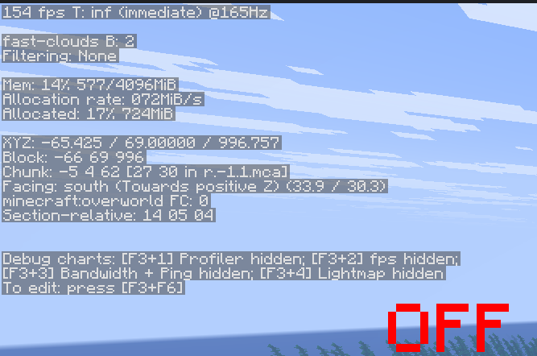
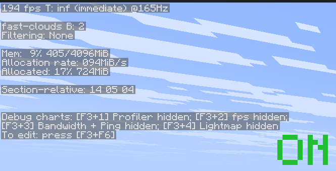
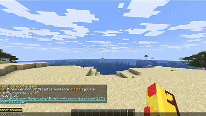
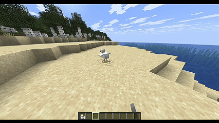
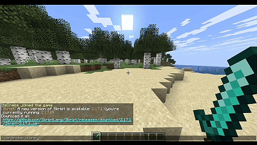
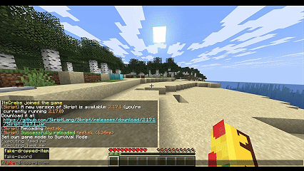
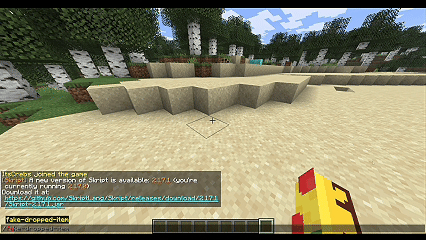
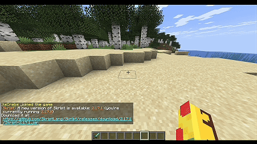
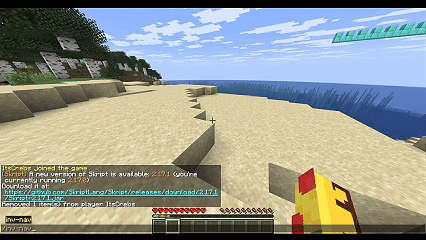
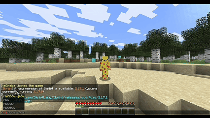

<div align="center">

# skPackets

**A drop-in alternative to PacketEventsSK for Skript.**

Create client-side entities, send packets, and change what individual players see without modifying the server-side world or inventory.

<a href="https://skdocs.org/?addon=skPackets">
  
</a>

[Features](#features) · [Requirements](#requirements) · [Showcases](#showcases) · [Persistence](#persistence) · [Credits](#credits)

</div>

---

## Features

| Feature | Description |
| :--- | :--- |
| **Packets** | Create and send clientbound packets, including camera and entity status packets. |
| **Packet entities** | Spawn client-side players, dropped items, and other entities for selected viewers. |
| **Equipment** | Show different equipment on real or fake entities without changing their actual items. |
| **Blocks** | Change the appearance of blocks for individual players without editing the world. |
| **Inventory** | Display fake items in slots, including the crafting grid and result slot. |
| **Teams** | Manage packet team membership and colors. |
| **Persistence** | Reapply supported visual changes after client or server updates. |

> [!IMPORTANT]
> Packet-based changes are visual. They do not create real items, modify blocks, or apply gameplay effects. Implement any required server-side behavior separately.

## Requirements

| Dependency | Version | Notes |
| :--- | :--- | :--- |
| Paper | **26.3+** | Required |
| Skript | **2.17.0+** | Required |
| PacketEvents | **2.14.0+** | Required |
| [SkBee](https://modrinth.com/plugin/skbee/versions) | **3.26.0+** | Optional; enables the NBT Compound hook |

Only the latest supported Skript and Minecraft versions receive support. Older versions may work, but are not officially supported.

---

## Showcases

These examples demonstrate skPackets in-game. Each showcase includes a preview and a collapsible Skript example.

| Demo | Command / trigger | Feature |
| :--- | :--- | :--- |
| [Reduced F3 Information](#reduced-f3-information) | `/reduced-debug` | Entity status packets |
| [Totem Pop](#totem-pop) | `/second-chance` | Entity status packets |
| [Camera Packet](#camera-packet) | `/change-camera` | Camera control |
| [Wardrobe Clone](#wardrobe-clone) | `/wardrobe-clone` | Fake players and equipment |
| [Fake Equipment](#fake-equipment) | `/fake-sword` | Equipment overrides |
| [Fake Dropped Item](#fake-dropped-item) | `/fake-dropped-item` | Persistent packet entities |
| [Fake Blocks](#fake-blocks) | Right-click a block | Block overrides |
| [Inventory Navigation](#inventory-navigation) | `/inv-nav` | Inventory slot overrides |
| [Rainbow Glow](#rainbow-glow) | `/rainbow-glow` | Packet teams and colors |

### Reduced F3 Information

Use `/reduced-debug` to toggle the vanilla reduced-debug view, which hides coordinates from the F3 screen. Run the command again to restore the normal view.

<div align="center">

 

<sub>Normal F3 (left) and reduced F3 (right)</sub>

</div>

> [!NOTE]
> This only changes the vanilla debug display. Modified clients can still determine the player's position. Test in a world where reduced debug information is normally disabled.

<details>
<summary><strong>View example</strong> · /reduced-debug</summary>

```vb
command /reduced-debug:
    trigger:
        set {_uuid} to uuid of player
        if {-showcase::reducedDebug::%{_uuid}%} is true:
            delete {-showcase::reducedDebug::%{_uuid}%}
            set {_status} to 23
            send "Reduced debug information disabled." to player
        else:
            set {-showcase::reducedDebug::%{_uuid}%} to true
            set {_status} to 22
            send "Reduced debug information enabled. Open F3!" to player
        set {_packet} to a new clientbound entity status packet:
            entity id: protocol id of player
            status: {_status}
        send packet {_packet} to player
```

</details>

### Totem Pop

Run `/second-chance` to play the totem animation without consuming a totem or taking damage. It does not grant resurrection or potion effects.

<p align="center">
  
</p>

<details>
<summary><strong>View example</strong> · /second-chance</summary>

```vb
command /second-chance:
    trigger:
        set {_packet} to a new clientbound entity status packet:
            entity id: protocol id of player
            status: 35
        send packet {_packet} to player
```

</details>

### Camera Packet

Look at a nearby entity and run `/change-camera` to switch your camera to it for five seconds. The entity must remain visible to your client.

<p align="center">
  
</p>

<details>
<summary><strong>View example</strong> · /change-camera</summary>

```vb
command /change-camera:
    trigger:
        set {_target} to target entity of player
        if {_target} is not set:
            send "Look at a nearby mob first." to player
            stop
        set {_camera} to a new clientbound camera packet:
            entity id: protocol id of {_target}
        send packet {_camera} to player
        wait 5 seconds
        set {_reset} to a new clientbound camera packet:
            entity id: protocol id of player
        send packet {_reset} to player
```

</details>

### Wardrobe Clone

Run `/wardrobe-clone` to create a fake player using your skin and currently equipped items. The equipment also appears when the fake entity is shown to new viewers.

<p align="center">
  
</p>

<details>
<summary><strong>View example</strong> · /wardrobe-clone</summary>

```vb
command /wardrobe-clone:
    trigger:
        set {_clone} to a new fake entity:
            entity: player
            username: "Clone"
            skin: skin of player
            location: location of player
            viewers: player
        set fake equipment helmet slot of {_clone} to player's helmet
        set fake equipment chestplate slot of {_clone} to player's chestplate
        set fake equipment leggings slot of {_clone} to player's leggings
        set fake equipment boots slot of {_clone} to player's boots
        set fake equipment main hand of {_clone} to player's held item
        wait 20 seconds
        kill fake entity {_clone}
```

</details>

To clear an equipment slot, use `delete fake equipment helmet slot of {_clone}`.

### Fake Equipment

Run `/fake-sword` to make other players see you holding a diamond sword without changing your actual inventory.

<p align="center">
  
</p>

<details>
<summary><strong>View example</strong> · /fake-sword</summary>

```vb
command /fake-sword:
    trigger:
        make fake equipment main hand of player as diamond sword to all players with persistent
        wait 10 seconds
        reset fake equipment main hand of player for all players
```

</details>

`with persistent` reapplies the override after equipment and tracking updates. Without it, the change is sent once. This does not change your first-person item or inventory screen.

Restore all equipment for selected viewers with `reset all fake equipment of player for all players`.
Resetting removes persistent overrides and shows the entity's current real equipment.

### Fake Dropped Item

Run `/fake-dropped-item` to display a diamond that only you can see. It is a packet entity, so it cannot be picked up.

<p align="center">
  
</p>

<details>
<summary><strong>View example</strong> · /fake-dropped-item</summary>

```vb
command /fake-dropped-item:
    trigger:
        set {_spot} to location of player
        set {_loot} to a new fake entity with persistent:
            entity: dropped item
            location: {_spot}~vector(0,2,0)
            viewers: player
            meta field:
                item: diamond
                gravity: false
        wait 20 seconds
        kill fake entity {_loot}
```

</details>

The persistent fake entity can be restored after supported updates and reconnects while it is still active. This example removes it after 20 seconds.

### Fake Blocks

Right-click a block to make it appear as gold for five seconds. Only you see the change; the real block is untouched.

<p align="center">
  
</p>

<details>
<summary><strong>View example</strong> · right-click a block</summary>

```vb
on right click:
    if clicked block isn't air:
        set {_loc} to location of clicked block
        make fake blocks at {_loc} as gold block to player with persistent
        wait 5 seconds
        reset fake blocks at {_loc} for player
```

</details>

Persistent block overrides can survive block updates and reconnects during the current server session, until they are reset or cleared.

### Inventory Navigation

Run `/inv-nav` to display a simple navigation menu in your own crafting grid. These are fake inventory items, not changes to your real inventory.

<p align="center">
  
</p>

<details>
<summary><strong>View example</strong> · /inv-nav</summary>

```vb
command /inv-nav:
    trigger:
        if gamemode of player is creative:
            send "Use survival or adventure to preview this." to player
            stop
        close player's inventory
        make fake inventory slot 1 as oak sign named "&fHelp" to player with persistent
        make fake inventory slot 2 as comparator named "&fSettings" to player with persistent
        make fake inventory slot 3 as chest named "&fMore" to player with persistent
        make fake inventory slot 4 as barrier named "&fExit" to player with persistent

on inventory click:
    if event-inventory is top inventory of player:
        send "Hey there!" to player
```

</details>

The persistent version reapplies the appearance after supported inventory updates and clicks. It does not protect the real inventory or spoof the cursor. [See the player inventory slot reference](#player-inventory-slots).

Restore individual raw slots or clear all fake inventory overrides:

```skript
reset fake inventory slots 1, 2, 3 and 4 for player
reset all fake inventory for player
```

These restore the current real items, including empty slots, and remove persistence. Individual slots refer to the current open inventory view.

### Rainbow Glow

Use packet teams to cycle through the supported team colors while applying the glowing effect. Team colors accept Skript colors without quotes; custom RGB colors map to the nearest supported color.

<p align="center">
  
</p>

<details>
<summary><strong>View example</strong> · /rainbow-glow</summary>

```vb
command /rainbow-glow:
    trigger:
        set packet glow state of player to true for player
        set {_team} to a new packet team:
            name: "Rainbow"
        add player to packet team {_team}
        loop all colors:
            set packet team color of {_team} to loop-value
            send packet {_team} to player
            wait 5 ticks
        send packet {_team} to player
        wait 5 seconds
        remove player from the packet team {_team}
        set packet glow state of player to false for player
        send packet {_team} to player
```

</details>

---

## Persistence

Persistence is opt-in. Add `with persistent` to a supported syntax to reapply a client-side override when relevant updates occur. Omit it for a one-time appearance.

| Override | Lifetime |
| :--- | :--- |
| **Inventory slots** | Player inventory: until disconnect. Container inventory: until the container closes. |
| **Equipment** | Until the viewer disconnects or the target unloads, dies, disconnects, or changes worlds. |
| **Fake blocks** | Survive block updates and reconnects during the server session, until reset or cleared. |
| **Fake entities** | Enable on creation with `a new fake entity with persistent:`. |

Reapplying an inventory or equipment override **without** `with persistent` replaces the persistent override with a one-time appearance.

> [!NOTE]
> Persistence is not permanent storage. Overrides are not saved across server restarts.

## Player Inventory Slots

The fake inventory slot syntax uses **raw slot indices**.

| Slot | Contents |
| :--- | :--- |
| `0` | Crafting result |
| `1–4` | 2×2 crafting grid |
| `5–8` | Armor: helmet, chestplate, leggings, boots |
| `9–35` | Main inventory |
| `36–44` | Hotbar |
| `45` | Offhand |

Container menus have their own raw slot layout, starting at `0` in the top inventory. Wait one tick after opening a container before sending fake slot contents. Creative mode has different item-creation behavior, so fake slots must not be used as an inventory protection mechanism.

## Credits

skPackets includes code adapted from **PacketEventsSK** by **3add**. The original MIT copyright and license notices are preserved in the relevant source files.
