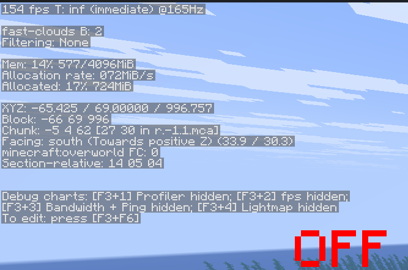
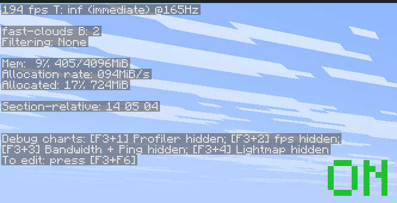
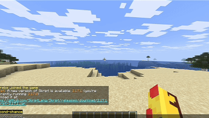
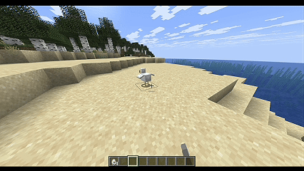
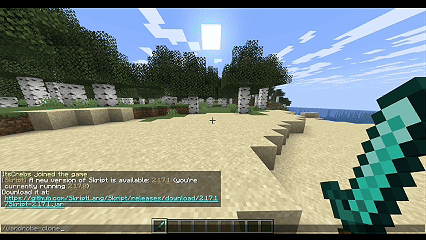
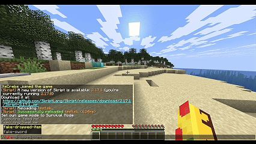
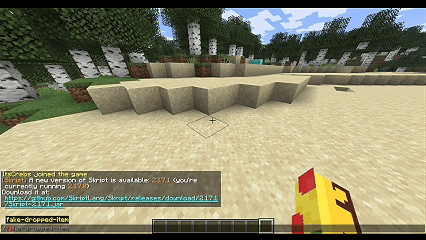
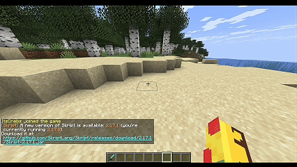
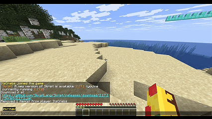
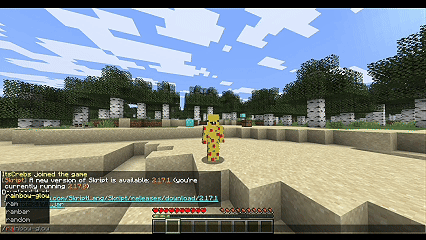

<div align="center">

# skPackets

**A drop-in alternative to PacketEventsSK for Skript.**

Work with packets directly in Skript and control what players see without changing the actual world or their inventories.

<a href="https://skdocs.org/?addon=skPackets">
  
</a>
<a href="http://skripthub.net/docs/?addon=skPackets">
  
</a>

<div align="center">

[](#features)
[](#requirements)
[](#showcases)
[](#persistence)
[](#credits)

</div>

</div>

---

## Features

skPackets lets you work with packets in Skript, whether you're making an NPC, a custom inventory menu or just experimenting with what the Minecraft client can do.

You can create your own clientbound packets, spawn fake entities that only certain players can see, and even give a player a different perspective using camera packets. Fake entities support things like player skins, dropped items and custom equipment.

You can also change how real entities, blocks and inventory slots look to individual players. For example, you could make someone appear to be wearing diamond armor without giving them any armor, show a different block to each player, or put navigation items in the crafting grid. Packet teams let you manage team membership and change team colors, which is useful for things like colored glowing outlines.

Some of these changes support persistence, so you don't have to keep sending packets yourself whenever the client receives an update.

Remember that these changes are client-side. A fake item isn't a real item, a fake block doesn't change the world, and a visual effect doesn't automatically apply any gameplay effects. You'll need to handle the actual server-side behavior in your script.

## Requirements

- Paper **1.21.11+**
- Skript **2.17.0+**
- PacketEvents **2.14.0+**
- [SkBee](https://modrinth.com/plugin/skbee/versions) **3.26.0+** (optional, only needed for the NBT Compound hook)

skPackets requires Java 21 or newer. Make sure you're running the Java version required by your Paper version and that your dependencies support the Minecraft version you're using.

---

## Showcases

Here are a few things you can make with skPackets. Each example has a preview and the Skript code, so you can try it yourself or use it as a starting point for something else.

### Reduced F3 Information

Want to hide coordinates from the F3 screen? You can send an entity status packet to toggle the reduced debug screen for a player. Run `/reduced-debug` again to bring back the normal F3 screen.

<div align="center">

 

<sub>Normal F3 (left) and reduced F3 (right)</sub>

</div>

> [!NOTE]
> Keep in mind that this only hides information from the vanilla debug screen. Modified clients can still find their coordinates. Try this in a world that normally has reduced debug information disabled.

<details>
<summary><strong>View example</strong></summary>

```vb
command /reduced-debug:
    trigger:
        set {_uuid} to uuid of player
        if {-showcase::reducedDebug::%{_uuid}%} is true:
            delete {-showcase::reducedDebug::%{_uuid}%}
            set {_status} to 23
            send "Reduced debug information disabled." to player
        else:
            set {-showcase::reducedDebug::%{_uuid}%} to true
            set {_status} to 22
            send "Reduced debug information enabled. Open F3!" to player
        set {_packet} to a new clientbound entity status packet:
            entity id: protocol id of player
            status: {_status}
        send packet {_packet} to player
```

</details>

### Totem Pop

You can play the totem animation whenever you want using an entity status packet. The player doesn't need to be holding a totem or taking damage. It's just the animation, so the player won't receive any potion effects or be resurrected.

<p align="center">
  
</p>

<details>
<summary><strong>View example</strong></summary>

```vb
command /second-chance:
    trigger:
        set {_packet} to a new clientbound entity status packet:
            entity id: protocol id of player
            status: 35
        send packet {_packet} to player
```

</details>

### Camera Packet

Camera packets let you see through another entity's eyes. This example switches your camera to the entity you're looking at and gives you back control of your camera after five seconds. Just make sure the entity stays visible to your client.

<p align="center">
  
</p>

<details>
<summary><strong>View example</strong></summary>

```vb
command /change-camera:
    trigger:
        set {_target} to target entity of player
        if {_target} is not set:
            send "Look at a nearby mob first." to player
            stop
        set {_camera} to a new clientbound camera packet:
            camera id: protocol id of {_target}
        send packet {_camera} to player
        wait 5 seconds
        set {_reset} to a new clientbound camera packet:
            camera id: protocol id of player
        send packet {_reset} to player
```

</details>

### Wardrobe Clone

Fake players are useful for things like NPCs or wardrobe previews. Here's a simple way to spawn a copy of yourself using your skin, armor and held item. The equipment stays with the fake player when you show it to other viewers.

<p align="center">
  
</p>

<details>
<summary><strong>View example</strong></summary>

```vb
command /wardrobe-clone:
    trigger:
        set {_clone} to a new fake entity:
            entity: player
            username: "Clone"
            skin: skin of player
            location: location of player
            viewers: player
        set fake equipment helmet slot of {_clone} to player's helmet
        set fake equipment chestplate slot of {_clone} to player's chestplate
        set fake equipment leggings slot of {_clone} to player's leggings
        set fake equipment boots slot of {_clone} to player's boots
        set fake equipment main hand of {_clone} to player's held item
        wait 20 seconds
        kill fake entity {_clone}
```

</details>

If you want to remove the clone's helmet, for example, use `delete fake equipment helmet slot of {_clone}`.

### Fake Equipment

What if you want other players to see you holding a diamond sword while you're actually holding something else? You can do that with fake equipment, without touching your real inventory.

<p align="center">
  
</p>

<details>
<summary><strong>View example</strong></summary>

```vb
command /fake-sword:
    trigger:
        make fake equipment main hand of player as diamond sword to all players with persistent
        wait 10 seconds
        reset fake equipment main hand of player for all players
```

</details>

Adding `with persistent` keeps the fake equipment visible after equipment and entity tracking updates. Leave it out if you only want to send the change once. Your own first-person view and inventory screen are unaffected.

To go back to showing the real equipment in every slot, use `reset all fake equipment of player for all players`. This also removes any persistent equipment overrides for those viewers.

### Fake Dropped Item

Here's how you can make a diamond float above a player without actually dropping an item in the world. Only that player can see it, and there's nothing for them to pick up.

<p align="center">
  
</p>

<details>
<summary><strong>View example</strong></summary>

```vb
command /fake-dropped-item:
    trigger:
        set {_spot} to location of player
        set {_loot} to a new fake entity with persistent:
            entity: dropped item
            location: {_spot}~vector(0,2,0)
            viewers: player
            meta field:
                item: diamond
                gravity: false
        wait 20 seconds
        kill fake entity {_loot}
```

</details>

The diamond can reappear after supported updates and even after reconnecting, as long as the fake entity is still active. In this example, we remove it after 20 seconds.

Standalone fake entities follow the viewer's effective view distance. They only appear in chunks the client has received and can reappear when those chunks are sent again. Mounted entities are handled differently since a rider's original spawn location might not match the vehicle's current location; their existing visibility behavior is unchanged.

### Fake Blocks

Fake blocks let you change how part of the world looks for a player without actually building or breaking anything. Try right-clicking a block with this example. It will look like gold for five seconds, but only to you.

<p align="center">
  
</p>

<details>
<summary><strong>View example</strong></summary>

```vb
on right click:
    if clicked block isn't air:
        set {_loc} to location of clicked block
        make fake blocks at {_loc} as gold block to player with persistent
        wait 5 seconds
        reset fake blocks at {_loc} for player
```

</details>

With persistence enabled, fake blocks can survive block updates and reconnects until you reset or clear them, as long as the server hasn't restarted.

You don't need to load distant chunks just to show fake blocks. skPackets groups updates by chunk section and remembers persistent blocks until the viewer receives their chunks. One-time changes are only sent to chunks that are already visible. When a lot of chunks arrive at once, the work of showing fake blocks again is batched and spread across ticks.

### Inventory Navigation

You can also use fake inventory slots to turn the crafting grid into a small menu. This example puts four navigation items in the grid without adding anything to the player's real inventory.

<p align="center">
  
</p>

<details>
<summary><strong>View example</strong></summary>

```vb
command /inv-nav:
    trigger:
        if gamemode of player is creative:
            send "Use survival or adventure to preview this." to player
            stop
        close player's inventory
        make fake inventory slot 1 as oak sign named "&fHelp" to player with persistent
        make fake inventory slot 2 as comparator named "&fSettings" to player with persistent
        make fake inventory slot 3 as chest named "&fMore" to player with persistent
        make fake inventory slot 4 as barrier named "&fExit" to player with persistent

on inventory click:
    if event-inventory is top inventory of player:
        send "Hey there!" to player
```

</details>

With persistence enabled, the fake items can reappear after supported inventory updates and clicks. You'll still need to handle the actual menu interactions yourself, since fake slots don't protect the real inventory or change the item on the cursor. If you're unsure which slot to use, check the [player inventory slot reference](#player-inventory-slots).

When you're done with the menu, you can reset the individual slots or clear all fake inventory items for the player:

```skript
reset fake inventory slots 1, 2, 3 and 4 for player
reset all fake inventory for player
```

Both reset effects remove the persistent overrides and show whatever is really in those slots, even if they're empty. When resetting individual slots, the indices refer to the currently open inventory view.

### Rainbow Glow

Packet teams can be used to change the color of a player's glowing outline for specific viewers. This example loops through all colors in Skript to make a rainbow glow. You can use Skript colors directly without quotes. Custom RGB colors are mapped to the closest supported team color.

<p align="center">
  
</p>

<details>
<summary><strong>View example</strong></summary>

```vb
command /rainbow-glow:
    trigger:
        set packet glow state of player to true for player
        set {_team} to a new packet team:
            name: "Rainbow"
        add player to packet team {_team}
        loop all colors:
            set packet team color of {_team} to loop-value
            send packet {_team} to player
            wait 5 ticks
        send packet {_team} to player
        wait 5 seconds
        remove player from the packet team {_team}
        set packet glow state of player to false for player
        send packet {_team} to player
```

</details>

---

## Persistence

By default, most visual changes are sent once. If the server sends another update, the client might go back to showing the real block, item or equipment. That's where `with persistent` comes in.

You can add it to supported syntaxes to let skPackets reapply the change for you. How long it lasts depends on what you're changing:

- **Fake inventory slots:** Changes to the player's own inventory last until they disconnect. Changes to a container inventory last until the container is closed.
- **Fake equipment:** Lasts until the viewer disconnects, or the target entity unloads, dies, disconnects or changes worlds.
- **Fake blocks:** Can survive block updates and reconnects during the current server session, until you reset or clear them.
- **Fake entities:** Enable persistence when creating the entity with `a new fake entity with persistent:`.

If you send another fake inventory or equipment change to the same slot without `with persistent`, it replaces the previous persistent change with a one-time one.

Persistence doesn't save anything to disk permanently. All of these persistent changes are lost when the server restarts.

## Player Inventory Slots

Fake inventory slots use raw slot indices, which aren't the same as the usual player inventory slot numbers. Here's how they're laid out in the player's own inventory:

- `0` is the crafting result.
- `1-4` are the four crafting grid slots.
- `5-8` are the armor slots, starting with the helmet and ending with the boots.
- `9-35` are the main inventory slots.
- `36-44` are the hotbar slots.
- `45` is the offhand slot.

Containers have their own layout, starting at slot `0` in the top inventory. If you're opening a container and then sending fake items to it, wait one tick after opening it.

Creative mode handles item creation differently, so don't rely on fake inventory slots to prevent players from taking or creating real items.

## Credits

skPackets is based in part on [PacketEventsSK](https://github.com/3add/PacketEventsSK) by [3add](https://github.com/3add). Credit goes to 3add for the original code. The original MIT copyright and license notices are kept in the relevant source files.
